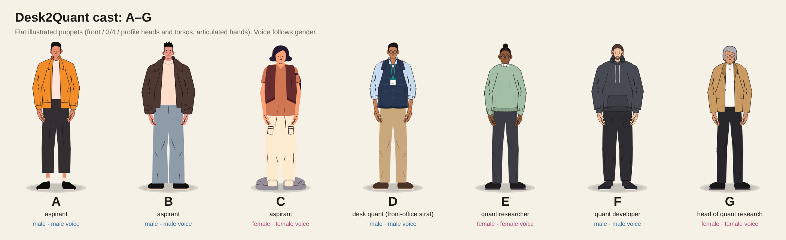

# Desk2Quant character kit (cast A–G)

The seven recurring characters of the Desk2Quant explainer reels, plus everything needed to animate them: rig, hands, gestures, walk, lip-sync, voices, office sets, QA and rendering. They are SVG puppets drawn in a flat illustrated style, deterministic in time, so any page can `seek(t)` and be rendered frame by frame.



| | Gender | Role | Look | Voice |
|---|---|---|---|---|
| **A** | male | aspirant | orange bomber, crew tee, cropped charcoal trousers, cream socks (can hold a coffee cup) | male |
| **B** | male | aspirant | oversized brown jacket, cream turtleneck, wide grey-blue jeans, fade haircut | male |
| **C** | female | aspirant | plum bob, rust tee, maroon open vest, cream cargo joggers, chunky sneakers, sling backpack | female |
| **D** | male | desk quant (front-office strat) | light-blue Oxford, rolled sleeves, navy quilted gilet, lanyard, tan chinos, glasses | male |
| **E** | female | quant researcher | high bun, round glasses, sage sweater over a white collar, charcoal trousers | female |
| **F** | male | quant developer | wavy hair, short beard, charcoal hoodie, headphones round the neck, black joggers | male |
| **G** | female | head of quant research | silver bob, glasses, camel blazer over a white top, black trousers | female |

Sheets: [lineup](sheets/lineup.png) · [turnarounds](sheets/turn.png) · [expressions](sheets/faces.png) · [gestures](sheets/gestures.png)

## Files

```
rig/hand.js      articulated hands (poses: relaxed, point, open, wave, fist, cup, phone, two, three, four, thumbsup, ok, present, ...)
rig/cast.js      the puppet (Cast class) + A, B, C; front / 3/4 / profile heads and torsos, limbs drawn from the bones
rig/quants.js    D, E, F, G (same spec format)
rig/motion.js    Motion.walk, turn, blink, talk, reach (anticipation, arcs, overshoot)
rig/gest.js      gesture library + Gest.track (keyed, blended gestures per arm)
rig/gest2.js     gestures v2: accurate pointing and presenting, levels, air quotes, palm-turn rules
kit.js           Kit: castIn, stand, talker, acting, facing, lookTrack, lerpPose, lipFrom, nodFrom, accentFrom, probe, CAST table
sets/env.js      office sets and props (sky, skyline, window wall, desk, monitor, laptop, keyboard, mug, plant, lamp, shelf, clock, ...)
sheet.html       model sheets (?s=lineup | turn | faces | gestures)
demo.html        6 s working scene: C walks in, D points, presents and explains, C waves
tools/           render.mjs (frames -> mp4 with motion blur), moaudit.mjs (60 Hz joint-pop audit), sheet.mjs (sheets -> PNG)
voice/           casting rules, male (Chatterbox) and female (Kokoro) voice tools, alignment, lip-sync, casting check
```

Load order in a page: `rig/hand.js, rig/cast.js, rig/quants.js, rig/motion.js, rig/gest.js, rig/gest2.js, sets/env.js, kit.js`.

## Quick start

```js
const { V, mk, castIn, talker, acting, facing, lookTrack } = Kit;
const D = castIn(svgGroup, 'D');                          // 'A'..'G'
const poseD = talker(D, 780, 1560, 1.45, {                // x, ground y, scale (1 = ~640 px tall)
  turn: facing([[0, -.25]]),                              // f: 0 front, ±0.55 three-quarter, ±1 profile
  act: acting([[0, 'neutral'], [1.0, 'focus'], [3.6, 'smile']]),
  g: [Gest.track(D, [[0, 'rest'], [1.1, 'pointAt', .45, { target: V(680, 470) }], [3.4, 'rest', .55]], 0),   // arm 0 = screen-left
      Gest.track(D, [[0, 'home'], [3.7, 'explain', .5], [5.0, 'home', .5]], 1)],                              // arm 1 = screen-right
  look: lookTrack([[0, V(0, 1)], [1.0, V(-6, -2)]]), lip: Kit.lipFrom(window.LIPS, 'D'), blinks: [2.2] });
window.seek = t => D.pose(poseD(t));
```

Walking: `const wk = Motion.walk(C, { t0, x0, x1, ground, f: 1, s, T: .5, step: 104 })` gives a pose function, and `wk.t1` is the arrival time. Blend into a standing talker with `Kit.lerpPose`; `demo.html` shows the hand-off.

Gesture keys are `[t, name, duration, opts]`. `pointAt`, `presentTo`, `presentSide` and `presentLow` take `{ target }`, either a point or a function of time (for a moving camera or parallax layer, map the target into the cast layer's coordinates).

## Gesture rules (what makes the motion read as professional)

- **Point at the real thing.** Give `pointAt` the on-screen element's coordinates. A high target caps the arm at about 55° and re-aims the index finger, so it never turns into a raised hand. Use the arm nearest the target, and keep the hand off the text it points at (`drop` lowers it).
- **Present, don't wave.** Use an open palm toward a list or panel with `presentSide`, which stays at chest height. Use `presentTo` only for targets near shoulder height.
- **One talking hand.** Use `explain` or `homeOpen` on the inner arm and keep the other relaxed (`rest` / `home`). Avoid long holds: point, relax, point again.
- **No hands on the face while speaking** (no chin-on-hand `think`). Don't reach past or over props.
- Gestures for the words: `one`..`four` for counted lists; `quote` + `quoteCurl` for air quotes (frame wide enough for both hands); `chest` for "me / owns"; `levelLow/Mid/Up/High` for floor and ceiling; `shrug` + `shrug2` (never twinned); `wave` to sign off.
- After any motion change, run `node tools/moaudit.mjs <page>` from this folder and aim for 0 flags (joint jumps at 60 Hz).

## Rendering

```bash
cd characters
PAGE=demo.html node tools/render.mjs 30 0 180 /tmp/demo.mp4 8    # 30 fps, frames 0-180, 8-subframe motion blur
node tools/moaudit.mjs demo.html                                 # frames 361 flags 0
node tools/sheet.mjs                                             # rebuild sheets/*.png
```

Pages must expose `window.ready` (a promise), `window.seek(t)` and `window.DUR`. The audit also needs `window.__probe = Kit.probe`. Playwright and Chromium come preinstalled in Claude Code cloud sessions.

## House rules for Desk2Quant content

No bank logos or employer branding on characters or sets. No prices, discounts or coupon codes, and no framing around bugs in Desk2Quant products. Don't use the founder's voice, and never say the narration is AI. Voices follow gender (see `voice/README.md`). Use only assets Desk2Quant owns or has rights to.
